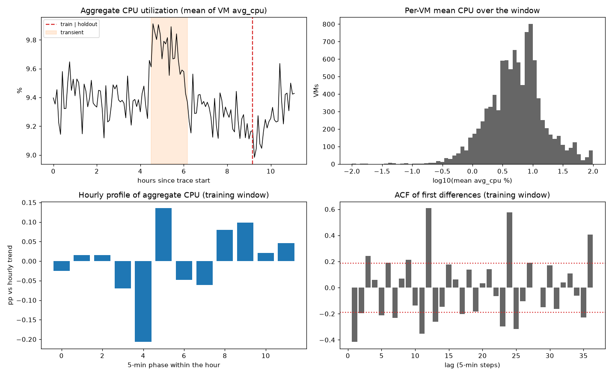
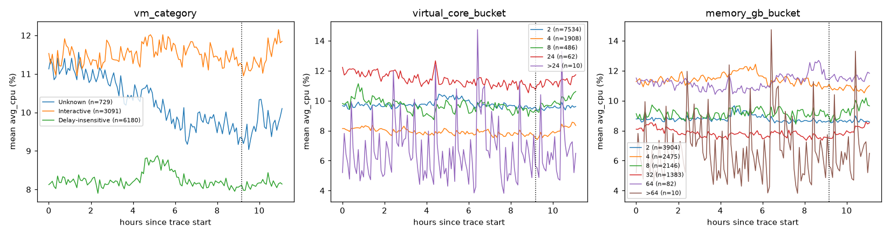
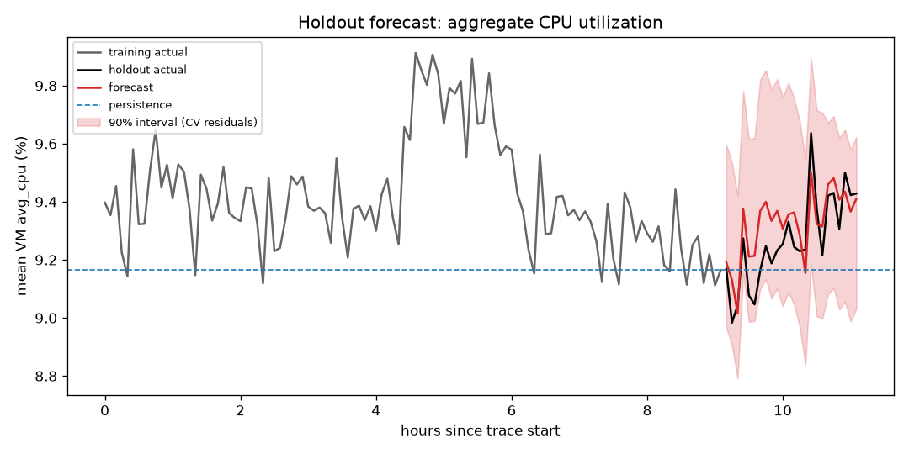
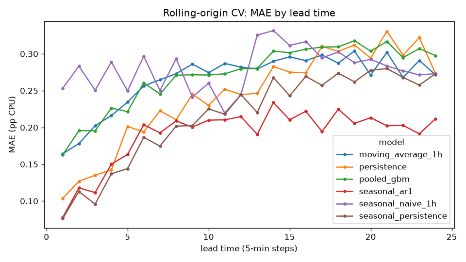

# Cloud Workload Forecasting: Final Report

Dataset: Azure Public Dataset V2, challenge release `data-v1` (10,000 VMs x 134 five-minute
steps). Every number in this report comes from the commands in the README.
`reports/eda_summary.md`, `artifacts/cv_summary_*.csv`, `reports/holdout_metrics.csv`,
`reports/policy_tradeoff.csv` and `reports/segment_study.csv` contain the full tables.

## 1. Executive summary

- **`active_vm_count` is exactly 10,000 at every timestamp.** This comes from how the release
  was built: only VMs with complete 134-step traces were kept. It is not a property of the
  workload. Persistence forecasts it perfectly (MAE 0 in CV and on the holdout). The count
  says nothing about real churn. The metadata shows 17.9% of these VMs are deleted later in
  the 30-day trace.
- **`aggregate_cpu_utilization` is low, flat and quite predictable.** The mean is 9.41% and
  the standard deviation is 0.19 pp over the training window. It has a stable one-hour cycle
  (peak-to-trough 0.34 pp; lag-12 autocorrelation of differences 0.61). It also had one
  ~1.8-hour transient of +0.36 pp, driven by batch (delay-insensitive) VMs.
- **Selected model: seasonal AR(1).** It combines an hourly profile with a level that
  reverts to the mean. Selection used a 20-origin rolling backtest inside the first 110 steps.
  In that backtest, it reduced MAE by 22% and RMSE by 22% compared with persistence. On the
  untouched 2-hour holdout, MAE was **0.091 pp against 0.147 pp for persistence (−38%)**, with
  RMSE 0.105 against 0.185. That is about 1% relative error.
- **Where it fails:** It does not anticipate batch transients, and while one is happening it
  under-forecasts. Its peak-period bias in CV is −0.16 pp, and its peak MAE is 11% worse than
  persistence. It also fails on segments with a trend.
- **Recommendation:** Provision the 2-hour pool capacity at forecast + 0.40 pp, which is the
  95th percentile of backtest residuals. In CV this policy was short in 5% of 5-minute
  intervals, with mean headroom of 0.48 pp. Add a persistence guard that applies when
  observed load moves above the forecast band. Treat delay-insensitive load as schedulable
  rather than as capacity to reserve.

## 2. Data understanding and preprocessing

**Integrity.** All SHA-256 checksums match. There are 1,340,000 rows and 134 timestamps from
0 to 39,900 s, spaced exactly 300 s apart. There are no duplicate `(vm_id, timestamp)` pairs,
no missing or out-of-range values, and no `min_cpu <= avg_cpu <= max_cpu` violations. Every
VM has 134 readings and exactly one metadata row. The data has no clock time. Timestamps are
seconds since trace start, so this report uses "hours since start" and does not claim a time
of day.

**Target construction (`cwfc/data.py`).** The pipeline is written for messier input than the
release, because reviewers may run it on a smoke dataset:

- A reading is valid when `avg_cpu` is finite and in [0, 100]. Invalid rows are dropped and
  counted.
- Timestamps snap to the dominant grid step. Duplicate VM readings in one slot collapse to
  their mean, so a VM is counted at most once.
- `active_vm_count(t)` is the number of distinct VMs with a valid reading.
  `aggregate_cpu_utilization(t)` is the unweighted mean of their `avg_cpu`.
- If a grid timestamp has no readings, its count is 0 and its CPU is **NaN**. No value is
  invented. Only inside a training history are NaN targets linearly interpolated so that
  models can fit. Interpolation never reaches beyond the training window.
- The full target series is built first. The final 24 grid timestamps are then split off.
  `cwfc.predict` never computes holdout targets.

**Leakage in the metadata.** `avg_cpu`, `max_cpu` and `p95_max_cpu` in the metadata summarise
the full 30-day trace, and `timestamp_vm_deleted` is a future event. The VM window mean
correlates 0.87 with the metadata `avg_cpu`. These fields are tempting, but using them would
leak information from the future, so the models do not use them. `vm_category` is also
derived by Azure from lifetime behaviour. It is used only to segment the analysis.

## 3. Workload analysis

**Lifetimes and churn.** Every VM has `timestamp_vm_created = 0`. All of them were running
when the trace began, so lifetimes are left-censored. None of them is deleted inside the
11.1-hour window. 1,787 VMs (17.9%) are deleted before the 30-day trace ends, and the 10th
percentile of observed lifetime is 210 hours. The complete-trace selection removes every
short-lived VM, which in Azure is the majority. **Operational consequence:** this release
cannot support a VM-count forecast. A real deployment would need arrivals and departures
from the full trace.

**Utilization is skewed.** The median reading is 5.1%, the 90th percentile is 19.6% and the
99th percentile is 87.4%. 46% of VMs average under 5%, and the busiest 10% of VMs produce
44% of all CPU. At any timestamp, 1.1–1.5% of readings are above 80%. The fleet average of
about 9.4% therefore hides a small set of hot VMs. Pool-level capacity and per-VM sizing are
separate problems, and the aggregate forecast only covers the first.

**Temporal structure (training window only).** Level autocorrelation is 0.66 at lag 1 and
drops to about 0 by lag 24, so the series reverts to its mean within about 2 hours. The
differenced series has strong peaks at lags 12, 24 and 36 (0.61, 0.58, 0.41). This is a
**one-hour cycle**. It is stable: the profile estimated on each half of the training window
looks the same. The profile has a trough at phase 4 (−0.21 pp) and a spike at phase 5
(+0.14 pp), a pattern consistent with hourly cron or batch jobs. The median per-VM lag-12
autocorrelation is 0.22, so many individual VMs carry the cycle. With 11 hours of data, daily
and weekly seasonality cannot be identified.

**Peaks and low periods.** The highest load is 9.91% at hour 4.6, inside a transient from
hours 4.5 to 6.25 (steps 54–74). In that period the aggregate rises by 0.36 pp compared with
the rest of the training window. Delay-insensitive VMs contribute 0.29 pp of that rise,
interactive VMs 0.09 pp and unknown VMs −0.02 pp. The top 100 VMs, from 25 or more
deployments among the top 50, account for 71% of the rise. It is a coordinated batch
episode, not a fleet-wide drift. The lowest load is 9.11% at hour 9.0.

**Segments.**

| Segment | VMs | Mean CPU | Temporal std | Share of CPU |
|---|---:|---:|---:|---:|
| Delay-insensitive | 6,180 | 8.24 | 0.21 | 54% |
| Interactive | 3,091 | 11.49 | 0.26 | 38% |
| Unknown | 729 | 10.23 | 0.64 | 8% |

Interactive VMs run hotter and are steady. They also rise inside the holdout. Unknown VMs
fall steadily from about 11.3% to 9.3%, which is a trend and not noise. The 4-core bucket
runs coolest (7.9%). The 10 VMs with more than 24 cores are dominated by spikes, with a
temporal std of 2.0 pp.

## 4. Forecasting approach

Each candidate sees only a `History` that is truncated at the forecast origin
(`cwfc/forecasters.py`). The candidates are listed from simplest to most complex:

| Candidate | Description |
|---|---|
| `persistence` | last value (starter `persistence_forecast`) |
| `moving_average_1h` | mean of the last 12 steps |
| `seasonal_naive_1h` | value one hour earlier (starter `seasonal_naive_forecast`, season 12) |
| `seasonal_persistence` | last seasonally adjusted value + hourly profile. Ablation without mean reversion |
| `seasonal_ar1` | hourly profile + AR(1) on the adjusted series, reverting to its mean |
| `pooled_gbm` | bottom-up model: one `HistGradientBoostingRegressor` trained across VMs, direct multi-horizon. The aggregate is the mean of the VM forecasts |

**Seasonal AR(1).** The hourly profile is the mean deviation from a centred 2x12 moving
average, grouped by phase of the hour `(timestamp // 300) % 12`. The profile is centred to
zero. The phase is a calendar feature that is known for any future timestamp. The adjusted
series `z` follows `level(h) = mu + phi^h (z_last − mu)`, where `mu` is the mean of `z` over
the history and `phi` is its lag-1 autocorrelation clipped to [0, 1]. On the final training
window the estimate is 0.90, a half-life of about 33 minutes. The model has three ideas: the hour has a shape, the level
persists for a while, and the level reverts to the mean. Each idea comes from Section 3.

**Pooled GBM.** For each VM, the features are the last value, means over 3, 12 and 36 steps
and over the full history, the 12-step standard deviation, the same-phase value from one
hour earlier, the mean of the last 3 same-phase values, the lead time and the phase. Training
pairs `(origin, h)` must satisfy `origin + h ≤ len(history)`. The model uses squared loss on
purpose. The aggregate is a mean, so it needs conditional means, and an absolute loss would
predict medians that are biased low on right-skewed VMs. The model uses 3,000 sampled VMs
and every second origin.

**`active_vm_count`.** It uses the same univariate candidates. Every candidate scores 0 in
the backtest, so the tie goes to the simplest one, persistence.

## 5. Validation methodology

The validation uses rolling-origin evaluation **inside the first 110 steps only**. There are
20 origins at steps 48, 50, …, 86, each with a 24-step (2-hour) horizon. Each model is refit
at every origin. This reproduces the production task: given everything up to now, forecast
the next 2 hours. The minimum training length of 48 steps (4 hours) leaves enough cycles to
estimate the hourly profile. The candidate with the lowest mean MAE across all origins and
lead times is selected. It is then refit once on all 110 steps to forecast the holdout.
`cwfc.evaluate` scores the holdout once. Its output is reported here and was not used to
select a model.

"Peak" means an actual value above the 75th percentile of the history available at that
origin. The threshold therefore also uses only past data. On the holdout, the threshold is
the 75th percentile of the training window.

Honest caveats:

1. The 20 origins overlap and cover only one transient, so they are not 20 independent tests.
2. The EDA figure plots the full series, including the holdout, as a description of the
   data. Every modelling statistic (profile, ACF, model choice) comes from the training
   window, and selection runs automatically in code.
3. After the first backtest run, I changed the GBM training sample from 2,000 VMs with
   origin stride 3 to 3,000 VMs with stride 2. Its result moved with the subsample (CV MAE
   0.354 → 0.272), and a larger sample reduces that noise. It still came last among the
   non-naive models. I also removed an AR1+GBM ensemble (CV MAE ratio 1.08) to halve
   runtime. The holdout was not involved in either change.

## 6. Results versus baseline

**Rolling-origin CV (training window, aggregate CPU, pp):**

| Model | MAE | RMSE | sMAPE % | Bias | MAE vs persistence | MAE h1–6 | MAE h19–24 |
|---|---:|---:|---:|---:|---:|---:|---:|
| persistence | 0.243 | 0.297 | 2.55 | +0.128 | 1.00 | 0.151 | 0.305 |
| moving_average_1h | 0.265 | 0.308 | 2.79 | +0.099 | 1.09 | 0.209 | 0.285 |
| seasonal_naive_1h | 0.279 | 0.327 | 2.93 | +0.099 | 1.15 | 0.270 | 0.281 |
| seasonal_persistence | 0.215 | 0.274 | 2.26 | +0.093 | 0.89 | 0.126 | 0.270 |
| **seasonal_ar1** | **0.190** | **0.231** | **2.00** | **+0.047** | **0.78** | 0.137 | **0.205** |
| pooled_gbm | 0.272 | 0.306 | 2.86 | +0.108 | 1.12 | 0.210 | 0.306 |

**Holdout (24 steps, scored once):**

| Model | MAE | RMSE | sMAPE % | Bias | Max abs error | MAE vs persistence |
|---|---:|---:|---:|---:|---:|---:|
| **seasonal_ar1 (submitted)** | **0.091** | **0.105** | **0.98** | +0.055 | **0.205** | **0.62** |
| persistence | 0.147 | 0.185 | 1.59 | −0.104 | 0.471 | 1.00 |
| moving_average_1h | 0.123 | 0.161 | 1.33 | −0.053 | 0.420 | 0.84 |
| seasonal_naive_1h | 0.140 | 0.159 | 1.51 | −0.053 | 0.311 | 0.95 |
| seasonal_persistence | 0.140 | 0.176 | 1.51 | −0.120 | 0.352 | 0.95 |
| pooled_gbm | 0.142 | 0.169 | 1.53 | −0.033 | 0.356 | 0.97 |

`active_vm_count`: every model scores MAE 0 in CV and on the holdout.

The ablation separates the two parts of the gain. The hourly profile alone
(`seasonal_persistence`) reduces CV MAE by 11%. Adding mean reversion brings the reduction
to 22%, and nearly all of that extra gain is at long lead times: MAE at h19–24 falls from
0.305 to 0.205. The holdout ranking matches the CV ranking. The holdout shows the profile
working. The spike at hour 10.4 is phase 5 of the cycle, and the model forecasts it at the
right step, at 9.50% against an actual 9.64%. Persistence misses it by 0.47 pp. sMAPE has a
safe denominator here because CPU never comes near 0. The `eps` guard in `cwfc.metrics`
covers the general case.

## 7. Error and failure analysis

1. **Batch transients cannot be predicted from the aggregate.** In the CV, the steps inside
   the hour 4.5–6.25 transient have the following MAE: seasonal_ar1 0.243, persistence 0.232.
   Outside the transient: 0.158 against 0.249. The transient starts with no warning in the
   aggregate history. At the origin just before it starts (step 56), seasonal_ar1 has its
   worst fold (MAE 0.40). While the transient runs, mean reversion pulls the forecast back
   to the mean too early. The bias on transient steps is −0.13 pp, and on peak steps
   −0.16 pp. Peak MAE is 0.245 against 0.222 for persistence. **The model is most wrong
   when load is highest, and that is the case capacity planning cares about most.** Section
   8 handles this with the margin and a guard rule.
2. **Trending segments.** On the Unknown segment, which declines throughout, seasonal_ar1 is
   worse than persistence in CV (MAE 0.59 against 0.40). It keeps reverting to a historical
   mean that is no longer current. Interactive (0.18 against 0.27) and delay-insensitive
   (0.22 against 0.26) segments follow the aggregate pattern. The model therefore assumes a
   stationary level. A per-segment choice, or a damped trend, would be needed for drifting
   segments.
3. **The VM-level GBM does not beat the aggregate.** It treats each VM's high recent level
   as persistent. During the transient it keeps forecasting high after the batch jobs end,
   with forecast means of 9.64–9.74% against actual 9.36–9.51% at origins 62–70. Mean reversion is a
   property of the fleet: jobs start and stop on different VMs, and averaging cancels that
   out. A pooled VM model trained on 1–2 hours of labels per origin does not learn it.
4. **Late quiet origins (80–86).** Persistence is slightly better here (0.09–0.14
   against 0.14–0.18). When the level is already near the mean, the hourly profile adds
   some noise.
5. **The holdout is small.** It has 24 points and only 1 above the training 75th percentile.
   The −38% holdout gain is a small-sample result. The −22% from 20 CV origins is the better
   estimate of expected performance.

**Uncertainty.** The 90% intervals use empirical quantiles of the CV residuals for the
selected model, grouped in 30-minute lead-time blocks. They are about 0.66 pp wide and
skewed upward, because the residuals include the start of the transient. Coverage on the
holdout was 24/24. The intervals are conservative in quiet periods and correctly asymmetric
toward the risk of under-provisioning.

**Extension: segment-level bottom-up.** Seasonal_ar1 was run on each vm_category series and
the results were combined, weighted by VM count. This gives CV MAE 0.177 against 0.190 for
the direct model, and holdout MAE 0.086 against 0.091. The submitted model did **not**
change: I ran this study after scoring the holdout, and switching then would have been
selection informed by the holdout. The next iteration should add it as a pre-registered CV
candidate. Its CV result suggests it is worth adopting.

## 8. Capacity-planning recommendation

The **policy** is to provision pool CPU for the next 2 hours at
`forecast(t+h) + margin`, where the margin is a quantile of backtest residuals
(actual − forecast). Results from `reports/policy_tradeoff.csv`:

| Margin quantile | Margin (pp) | Short intervals (CV) | Mean shortfall when short (CV) | Mean headroom (CV) | Short intervals (holdout) |
|---|---:|---:|---:|---:|---:|
| none | 0.00 | 29% | 0.25 | 0.17 | 29% |
| q80 | 0.15 | 20% | 0.18 | 0.29 | 0% |
| q90 | 0.33 | 10% | 0.09 | 0.43 | 0% |
| **q95** | **0.40** | **5%** | **0.08** | **0.48** | **0%** |
| q99 | 0.50 | 1% | 0.10 | 0.55 | 0% |

**Recommendation: use q95, a margin of +0.40 pp**, about 4% above a forecast near 9.3%.

- **Trade-off.** Going from q90 to q95 adds only 0.05 pp of average headroom and halves the
  short intervals from 10% to 5%. Going from q95 to q99 costs another 0.08 pp to remove the
  last 4%. Under-provisioning causes CPU contention, latency for interactive tenants and SLA
  risk. Over-provisioning wastes capacity, but the pool already averages about 9.4%. A
  shortfall costs far more than the extra headroom, so the policy sits on the high-coverage
  side.
- **Peak-risk guard (failure mode 1).** If the observed aggregate is above the forecast's
  upper 90% band for 2 consecutive steps, a transient is probably under way. Provision at
  `max(forecast, last observed) + margin` until the load falls back inside the band. In CV,
  persistence had almost no bias on transient steps (−0.02 pp), so this guard removes the
  model's main weakness. It is a proposal: this data has only one transient, which is not
  enough to backtest the guard.
- **Segment rule.** Delay-insensitive VMs caused the only large peak. They should be handled
  by scheduling (stagger or defer batch jobs to avoid hourly phase 5 and large batch
  windows), not by reserving more peak capacity. Interactive VMs run hotter and are rising
  at the end of the window. They should get the margin first. For segments with a trend,
  such as Unknown, use persistence.
- **Scope.** This policy covers pool-level aggregate CPU. Per-VM autoscaling must use
  per-VM `max_cpu`, because 1–1.5% of VMs are above 80% at any time even while the pool
  sits at 9%.

## 9. Limitations and future work

- **11 hours of data.** Daily and weekly cycles, which drive most cloud capacity planning,
  cannot be seen. The approach would add them as more seasonal profiles if they are
  confirmed on longer data.
- **Survivorship selection.** Complete traces only means no churn, which explains why the
  VM count is constant. The CPU mix is also probably more stable than in the full fleet.
  Short-lived VMs need the upstream trace.
- **Unweighted mean.** The required target weights a 2-core VM the same as a 24-core VM.
  Physical demand needs core-weighted CPU, and `virtual_core_bucket` is only a bucket, so
  this would be an approximation.
- **Few independent events.** One transient, overlapping CV windows and a 24-point holdout
  give wide confidence ranges for every comparison. A longer trace with blocked CV would
  settle the comparison between seasonal_ar1 and segment bottom-up.
- **Next steps:** add segment bottom-up as a CV candidate, add a damped trend for drifting
  segments, use leading indicators for batch transients (for example, early ramp in
  delay-insensitive VMs at phase 4–5), and use regime-conditional intervals.
